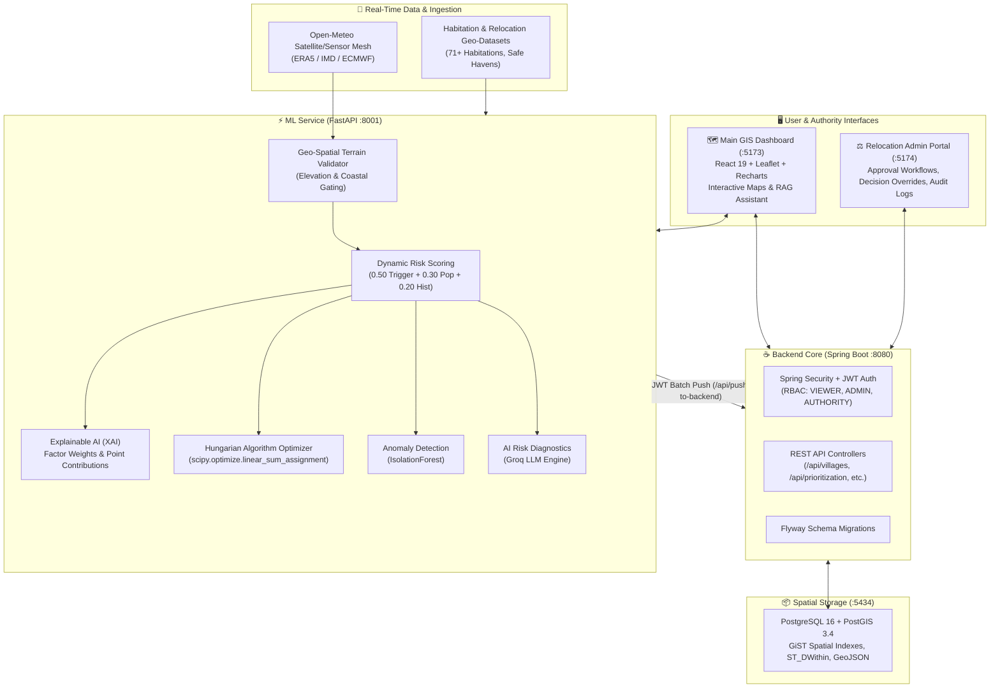

# 🌊 AI-Based Disaster Risk Assessment & Relocation Planning System (SIH26191)

[](https://github.com/ayushi847/ai-disaster-risk-planner)
[](https://python.org)
[](https://fastapi.tiangolo.com)
[](https://spring.io/projects/spring-boot)
[](https://postgis.net)
[](https://react.dev)
[](https://vitejs.dev)
[](https://leafletjs.com)
[](https://groq.com)

> **Repository**: [https://github.com/ayushi847/ai-disaster-risk-planner](https://github.com/ayushi847/ai-disaster-risk-planner)

An end-to-end, multi-tier decision-support platform designed for disaster management authorities (NDMA/SDMA) and district collectors to proactively assess disaster vulnerabilities, monitor real-time sensor and satellite telemetry, explain AI risk scores, and compute globally optimal, capacity-constrained relocation plans for vulnerable habitations across India.

---

## 📌 Table of Contents

- [Overview](#-overview)
- [System Architecture](#-system-architecture)
- [Core Features & Modules](#-core-features--modules)
  - [1. ML & Explainable AI (XAI) Engine](#1-ml--explainable-ai-xai-engine)
  - [2. Hungarian Optimization & Relocation Allocation](#2-hungarian-optimization--relocation-allocation)
  - [3. Unsupervised Anomaly Detection](#3-unsupervised-anomaly-detection)
  - [4. Real-Time Telemetry & Weather Sensor Integration](#4-real-time-telemetry--weather-sensor-integration)
  - [5. NDMA-RAG Contextual Intelligence Assistant](#5-ndma-rag-contextual-intelligence-assistant)
  - [6. Spring Boot & PostGIS Geospatial Core](#6-spring-boot--postgis-geospatial-core)
  - [7. Dual Frontend Portals](#7-dual-frontend-portals)
- [Port & Service Map](#-port--service-map)
- [Project Structure](#-project-structure)
- [Prerequisites & Installation](#-prerequisites--installation)
- [Quick Start (One-Click Launch)](#-quick-start-one-click-launch)
- [Manual Step-by-Step Setup](#-manual-step-by-step-setup)
- [Git Sync & Pushing to GitHub](#-git-sync--pushing-to-github)
- [API Documentation](#-api-documentation)
- [Default Credentials](#-default-credentials)
- [Team & Roles](#-team--roles)

---

## 🌟 Overview

Recurring natural hazards—including catastrophic riverine floods (Brahmaputra/Ganges), coastal cyclones and storm surges (Bay of Bengal / Arabian Sea), Himalayan landslides (Uttarakhand/Himachal), and subsidence/mine hazards (Jharia)—pose recurrent existential threats to thousands of habitations across India. 

Current disaster response is largely reactive, relying on delayed manual surveys and ad-hoc evacuation centers. This platform introduces a **proactive, data-driven, and transparent paradigm**:

1. **Predicts and Quantifies Hazard Vulnerability** across standardized hazard categories.
2. **Explains Every Score** transparently using factor contribution modeling and Groq LLM executive diagnostics.
3. **Solves the Relocation Dilemma** using bipartite matching (Hungarian Algorithm) that guarantees minimum evacuation distance while strictly respecting administrative state boundaries and shelter capacities.
4. **Feeds Live Ground & Satellite Telemetry** directly into dynamic risk calculation.
5. **Contextual AI via NDMA-RAG** providing interactive, zero-hallucination conversational querying on live field conditions and evacuation timelines.
6. **Maintains Complete Governance & Audit Trails** for every administrative approval, override, and relocation decision.

---

## 🏗️ System Architecture



---

## 🚀 Core Features & Modules

### 1. ML & Explainable AI (XAI) Engine
- **Formula**:
  ```
  Risk Score = (0.50 × Hazard Intensity) + (0.30 × Population Vulnerability) + (0.20 × Disaster Recurrence History)
  ```
- **Risk Categorization**:
  - `CRITICAL` — Score ≥ 75
  - `HIGH` — Score 60 – 74.9
  - `MEDIUM` — Score 40 – 59.9
  - `LOW` — Score < 40
- **Explainability**: Breaks down each habitation's score into exact contribution points, relative percentages, and dominant driving factor with plain-English rationales.
- **LLM Executive Summaries**: Powered by Groq AI (`groq/compound-mini`), generating 2–3 sentence authoritative diagnostics detailing geological hazard mechanics, vulnerable demographic scales, and immediate directives.

### 2. Hungarian Optimization & Relocation Allocation
- Solves settlement-to-safe-site allocation as a global minimum-weight bipartite matching problem using `scipy.optimize.linear_sum_assignment`.
- **Cost Matrix Formulation**:
  - **Base Distance**: Haversine great-circle distance (km) between habitation and relocation site.
  - **Cross-State Penalty**: +10⁹ cost addition to prevent inter-state administrative friction.
  - **Capacity Violation Penalty**: +10⁶ penalty when site capacity is lower than settlement population (discourages overcrowding while allowing safe fallback).

### 3. Unsupervised Anomaly Detection
- Leverages `sklearn.ensemble.IsolationForest` on multidimensional standardized features (`hazard_intensity`, `population`, `disaster_history_score`).
- Identifies data-entry inconsistencies, statistical anomalies, or extreme outliers requiring on-ground physical inspection.

### 4. Real-Time Telemetry & Weather Sensor Integration
- Dynamic Open-Meteo satellite and ground sensor mesh fetching live temperature, precipitation (current & 24h accumulated), soil saturation levels, wind speeds, and IMD alert levels.
- Real-time alert gating ensures alarms ≥ 70 strictly require active hydrological or meteorological triggers.
- Dynamic recalculation of **Estimated Time to Impact (ETI)** based on real-time weather progression.

### 5. NDMA-RAG Contextual Intelligence Assistant
- **Retrieval-Augmented Generation (RAG)** copilot embedded into the GIS dashboard (`RAGQueryPanel.jsx`).
- Powered by Groq LLMs (`qwen/qwen3.8-27b` with high-throughput fallbacks).
- Dynamically retrieves and injects the active habitation's live dossier:
  - Exact GPS coordinates & affected demographic headcount.
  - Multi-factor hazard intensity & risk tier breakdown.
  - Live satellite sensor readings (24h rainfall, soil saturation %, wind speed).
  - IMD alert badge status & dynamic risk delta.
  - Impact timeline (Lead time category, urgency rating, recommended evacuation directive).
  - Assigned evacuation shelter name, distance in km, capacity status, and amenities.
- Strict anti-hallucination system prompt to guarantee factually grounded answers.

### 6. Spring Boot & PostGIS Geospatial Core
- Spatial queries with native EPSG:4326 GeoJSON polygons and points.
- JPA Entities: `Village`, `HazardZone`, `RelocationSite`, `RiskAssessment`, `PrioritizationResult`, `RelocationDecision`, `AppUser`, `AuditLog`.
- Automated schema migrations via **Flyway**.
- JWT-based authentication with strict Role-Based Access Control (`VIEWER`, `ADMIN`, `AUTHORITY`).

### 7. Dual Frontend Portals
- **Main GIS Dashboard (`:5173`)**: Built with React 19, Leaflet, and Recharts. Features smooth wheel zoom, hazard radius circles, real-time sensor metrics, filterable risk tiers, habitation dossiers, and RAG copilot.
- **Relocation Authority Admin Portal (`:5174`)**: Dedicated dashboard for disaster mitigation officers to review AI recommendations, accept or override site assignments, input administrative notes, and review tamper-proof audit trails.

---

## 🌐 Port & Service Map

| Service | Port | Technology | Purpose |
| :--- | :--- | :--- | :--- |
| **PostGIS Database** | `5434` / `5432` | PostgreSQL 16 + PostGIS 3.4 | Spatial data storage & geometry indexing |
| **ML Engine** | `8001` | FastAPI, Scikit-learn, Scipy | Scoring, XAI, Hungarian optimization, LLM |
| **Spring Boot Backend**| `8080` | Spring Boot 3.3, Java 17/21 | REST API, JWT auth, decision lifecycle |
| **Main GIS Dashboard** | `5173` | React 19, Vite, Leaflet | Public & operational risk map visualization + RAG |
| **Relocation Admin** | `5174` | React 19, Vite, Oxlint | Administrative decision & audit portal |

---

## 📁 Project Structure

```text
ai-disaster-risk-planner/
├── start_all.sh                 # Master one-click startup script for all 5 services
├── stop_all.sh                  # Graceful shutdown script for background processes
├── final_api_v2.py              # FastAPI ML Service v2 main application
├── optimizer.py                 # Hungarian Algorithm optimization module
├── explainability.py            # Factor contribution & XAI breakdown
├── anomaly_detector.py          # IsolationForest outlier detection
├── live_weather_sensor.py       # Live Open-Meteo telemetry & sensor mesh
├── geo_validator.py             # Geospatial elevation & hazard terrain validator
├── llm_summarizer.py            # Groq AI risk summary generator
├── habitations_FINAL_checked.csv# Validated habitations dataset (71+ records)
├── relocation_sites_FINAL__1_.csv# Safe haven and shelter dataset
├── requirements.txt             # Python dependencies
├── seed_admin.sql               # Seed script for initial admin credentials
├── seed_villages.sql            # SQL seed script for villages
├── seed_relocation_sites.sql    # SQL seed script for relocation sites
│
├── repo_latest/
│   ├── backend/                 # Spring Boot Backend (Java 17/21, Maven)
│   │   ├── src/main/java/com/sih/relocation/
│   │   ├── src/main/resources/db/migration/ (Flyway SQL scripts)
│   │   ├── pom.xml
│   │   └── docker-compose.yml   # PostGIS container definition
│   ├── frontend/                # Main GIS Dashboard (React 19 + Leaflet + RAG Panel)
│   ├── relocation-admin/        # Relocation Authority Admin Portal (React 19 + Vite)
│   └── ml/                      # Mirrored ML service module
└── README.md                    # Root documentation
```

---

## ⚙️ Prerequisites & Installation

Ensure you have the following installed on your machine:
- **Docker Desktop** (for PostgreSQL + PostGIS)
- **Python 3.10+**
- **Java JDK 17 or 21**
- **Apache Maven 3.8+**
- **Node.js 18+ & npm**
- **cURL**

---

## ⚡ Quick Start (One-Click Launch)

To spin up all 5 services with a single command:

```bash
chmod +x start_all.sh stop_all.sh
./start_all.sh
```

The script will sequentially:
1. Boot the Docker PostGIS container on port `5434`.
2. Launch the FastAPI ML Engine on port `8001`.
3. Start the Spring Boot Backend on port `8080` and wait for health check confirmation.
4. Automatically trigger `/api/push-to-backend` to sync ML risk scores and relocation plans into PostgreSQL.
5. Launch the Main GIS Dashboard on port `5173`.
6. Launch the Relocation Authority Admin Portal on port `5174`.

To cleanly terminate all running services:
```bash
./stop_all.sh
```

---

## 🛠️ Manual Step-by-Step Setup

If you prefer launching individual services manually:

### 1. Database (PostGIS)
```bash
cd repo_latest/backend
docker compose up -d db
```

### 2. ML Service (FastAPI)
```bash
# In the project root (or inside repo_latest/ml)
python3 -m venv venv
source venv/bin/activate
pip install -r requirements.txt

# Create .env and configure your Groq API key
cp .env.example .env

# Run FastAPI
uvicorn final_api_v2:app --host 0.0.0.0 --port 8001 --reload
```

### 3. Spring Boot Backend
```bash
cd repo_latest/backend
mvn clean spring-boot:run
```

### 4. Push ML Scores to Backend
Once both Backend and ML service are up:
```bash
curl -X POST http://localhost:8001/api/push-to-backend
```

### 5. Main GIS Dashboard
```bash
cd repo_latest/frontend
npm install
npm run dev -- --host 0.0.0.0
```

### 6. Relocation Authority Admin Portal
```bash
cd repo_latest/relocation-admin
npm install
npm run dev -- --host 0.0.0.0
```

---

## 🔄 Git Sync & Pushing to GitHub

To commit and push this `README.md` and any updates to the GitHub repository:

```bash
cd repo_latest

# Stage the README and changes
git add README.md

# Commit
git commit -m "docs: add comprehensive architecture, ML, and RAG documentation"

# Push to your remote (e.g. origin main)
git push origin main
```

---

## 📖 API Documentation

### ML Service (FastAPI — Port `8001`)
- **Interactive Swagger Docs**: [http://localhost:8001/docs](http://localhost:8001/docs)
- **Key Endpoints**:
  - `GET /api/risk-scores` — Habitation risk scores, XAI breakdowns, and LLM summaries.
  - `GET /api/prioritization` — Hungarian relocation site allocations.
  - `GET /api/anomalies` — Habitations flagged by IsolationForest.
  - `GET /api/realtime-weather/{village_id}` — Live weather and soil moisture telemetry.
  - `GET /api/live-sensor-feed` — Sensor stream across all active zones.
  - `GET /api/active-alerts` — Active high-severity alerts.
  - `POST /api/recompute` — Trigger recalculation of risk scores.
  - `POST /api/push-to-backend` — Synchronize ML results to Spring Boot.

### Spring Boot Backend (Port `8080`)
- `POST /api/auth/login` — Authenticate and receive Bearer JWT token.
- `GET /api/villages` — Retrieve all habitations with geospatial geometry.
- `GET /api/hazard-zones` — Geospatial polygons of delineated hazard zones.
- `GET /api/relocation-sites` — Candidate shelter and rehabilitation sites.
- `GET /api/prioritization` — Relocation prioritization list.
- `POST /api/decisions` — Create or update administrative relocation approvals.
- `GET /api/audit-logs` — Immutable audit records of officer actions.

---

## 🔑 Default Credentials

- **Admin Account**:
  - **Email**: `admin@sih.gov.in`
  - **Password**: `admin123`
  - **Role**: `ADMIN` / `AUTHORITY`
- **PostGIS Database**:
  - **Host**: `localhost`
  - **Port**: `5434` (mapped from container 5432)
  - **Database**: `disaster_relocation`
  - **User**: `postgres`
  - **Password**: `postgres`

---

## 👥 Team & Roles

| Member | Focus Area | Key Modules |
| :--- | :--- | :--- |
| **Purwansh** | Backend Architecture & Spatial DB | Spring Boot REST API, Flyway, PostGIS, JWT Security |
| **Jenam** | Machine Learning, XAI & Sensor Mesh | Dynamic Risk Scoring, XAI Engine, Open-Meteo Telemetry |
| **Tanmay** | Optimization Algorithms | Hungarian Algorithm, Linear Sum Assignment, Capacity Cost Penalties |
| **Karan** | Geospatial Data & Pipeline | GeoJSON Ingestion, Terrain/Elevation Validation, GIS Data Cleaning |
| **Ayushi** | Frontend GIS Dashboard & RAG | Interactive Leaflet Map, Sensor Badges, Recharts Analytics, NDMA-RAG Copilot |
| **Mrinal** | Relocation Admin Portal | Authority Review Workflows, Administrative Overrides, Audit Trail UI |

---

<p align="center">
  <b>Developed for Smart India Hackathon (SIH 2026)</b><br>
  <i>AI-Based Disaster Risk Assessment & Relocation Planning System</i><br>
  <a href="https://github.com/ayushi847/ai-disaster-risk-planner">github.com/ayushi847/ai-disaster-risk-planner</a>
</p>
